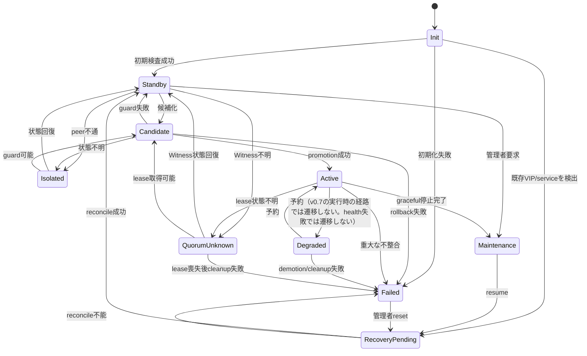

# State Machine

> 開発者向けの設計・検証の記録です。開発の工程の識別子（段階や判断の番号）と、公開候補に含まれない内部の資料への参照を含みます。利用の手順は [`README.md`](../README.md) と [`configuration.md`](configuration.md) を参照してください。

## NodeState

```text
Init
Standby
Candidate
Active
Degraded
Isolated
QuorumUnknown
RecoveryPending
Maintenance
Failed
```

NodeStateはノードの役割・安全状態を表す。promotion/demotionの細部はOperationPhaseで表す。

## State diagram



## Promotion

開始条件は、候補選択、term/lease/quorum、peer状態、cleanup状態、cooldown、VIP状態の確認がすべて成功すること。conservativeではWitnessなし、または旧Activeの停止・cleanupが不明な場合は開始しない。

順序は固定する。

```text
promotion guard
→ lease確認/取得
→ VIP取得
→ service起動
→ health check
→ gratuitous ARP
→ Active
```

health checkまたはGARPが失敗した場合は、service停止、停止確認、VIP解放、解放確認を行う。cleanup未確認なら`Failed`で停止する。

## Demotion

demotion開始条件は、管理者要求、safety marginを差し引いて算出したNode側local expiryへの到達、重大な不整合、maintenance移行など。Activeの間のhealthの失敗は、`[health]`の閾値で安定した状態の変化を警告のログに出すだけで、Degradedへの遷移とdemotionの条件にしない（v1.0 D-5）。promotionの途中のhealth check（`WaitForHealth`）は従来どおりpromotionのgateである。順序は以下のとおり。

```text
StopService
→ ConfirmServiceStopped
→ ReleaseVIP
→ ConfirmVIPReleased
→ ReleaseLease
→ CommitStandby
```

どの確認にも失敗した場合は実行中OperationPhaseを破棄して`Failed`に遷移し、自動promotionを許可しない。

## OperationPhase

Promotion：

```text
CheckPromotionGuard
AcquireLease
AcquireVIP
StartService
WaitForHealth
AnnounceGratuitousARP
CommitActive
Rollback
```

Demotion：

```text
StopService
ConfirmServiceStopped
ReleaseVIP
ConfirmVIPReleased
ReleaseLease
CommitStandby
```

## Restart and reconcile

再起動時は保存されたOperationPhaseやoperation_idから処理を再開しない。

```text
Init
→ RecoveryPending
→ VIP/service/peer/Witness/term/leaseを再観測
→ reconcile
→ StandbyまたはFailed
```

既存リソースが残っている場合、状態を不明として扱い、自動Active化しない。

## Guarantees and limitations

状態機械は、promotion順序、cleanup確認、lease喪失時の自己demotion開始、再起動時のreconcileを管理する。fencingなしでは、処理が実行されない停止・OS hang・VIP解放失敗などによる実リソースの二重稼働を保証付きで防止しない。
